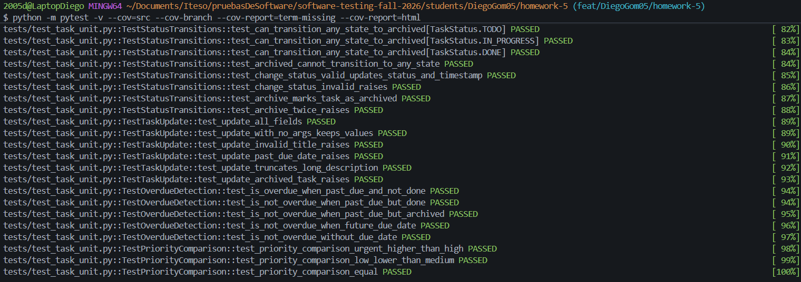
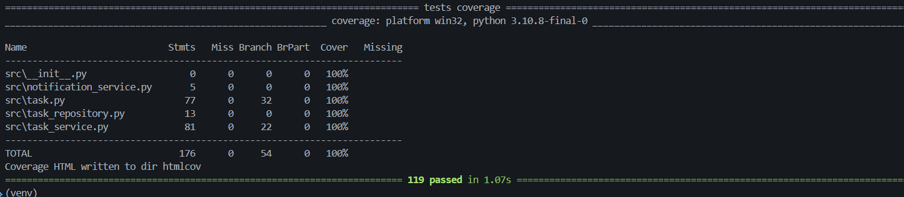
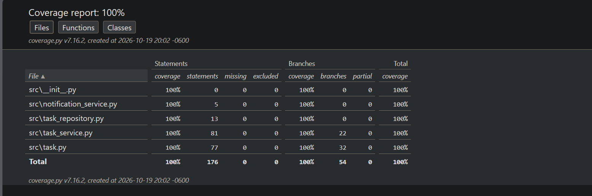

# Coverage Analysis - TaskFlow

## Coverage Summary

| Metric             | Threshold | Achieved | Status  |
| ------------------ | --------- | -------- | ------- |
| Statement Coverage | 80%       | 100%     | ✅ Pass |
| Branch Coverage    | 80%       | 100%     | ✅ Pass |
| Function Coverage  | 80%       | 100%     | ✅ Pass |
| Line Coverage      | 80%       | 100%     | ✅ Pass |

Total: 176 statements, 54 branches, 0 missed, 0 partial branches. 119 tests passed.

Command used:

```bash
pytest -v --cov=src --cov-branch --cov-report=term-missing --cov-report=html
```

## Coverage by File

| File                    | Statements | Branches | Functions | Lines |
| ----------------------- | ---------- | -------- | --------- | ----- |
| task.py                 | 100%       | 100%     | 100%      | 100%  |
| task_service.py         | 100%       | 100%     | 100%      | 100%  |
| task_repository.py      | 100%       | n/a      | 100%      | 100%  |
| notification_service.py | 100%       | n/a      | 100%      | 100%  |

`task_repository.py` and `notification_service.py` contain no branches. Function
coverage is 100% because no statement is missed, so every function body ran at least once.

## Untested Code Paths

No uncovered lines or branches were reported. The following code is covered, but only
superficially, so it deserves an honest note:

### task_repository.py / notification_service.py - `raise NotImplementedError`

**Reason**: These methods are interface stubs. They are covered only by tests asserting
that they raise `NotImplementedError`. In production they would be replaced by a real
database or provider implementation, which belongs to system/end-to-end tests.

**Risk**: Low - no business logic.

### task_service.py - exception handlers in `_notify_email` / `_notify_sms`

**Reason**: Covered with `side_effect` mocks, but real network failures (timeouts,
retries, partial deliveries) are not simulated.

**Risk**: Low - failures are logged and never break the workflow.

## Screenshots





## How Coverage Goals Were Achieved

### Initial Coverage

After the unit tests of the Task model, `task.py` was near 100%, but `task_service.py`,
`task_repository.py` and `notification_service.py` were at 0% because they had no tests yet.

### Strategy Applied

1. **Unit tests for the model**: boundary values, every transition, overdue cases.
2. **Integration tests with mocks** covering every branch of `create_task`,
   `update_task`, `update_task_status`, `delete_task`, `check_overdue_tasks`
   and `search_tasks`.
3. **Error scenarios** with `side_effect` (database and notification failures).
4. **Edge-case tests** for remaining branches (empty filters, tasks without due date,
   description truncation).
5. **Interface tests** asserting that the stubs raise `NotImplementedError`.

### Final Coverage

100% statements and 100% branches with 119 tests, running in about 1 second.
