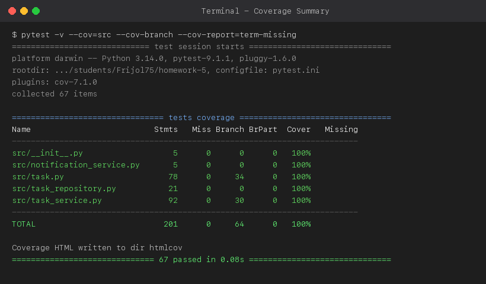
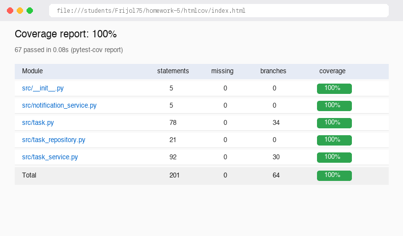
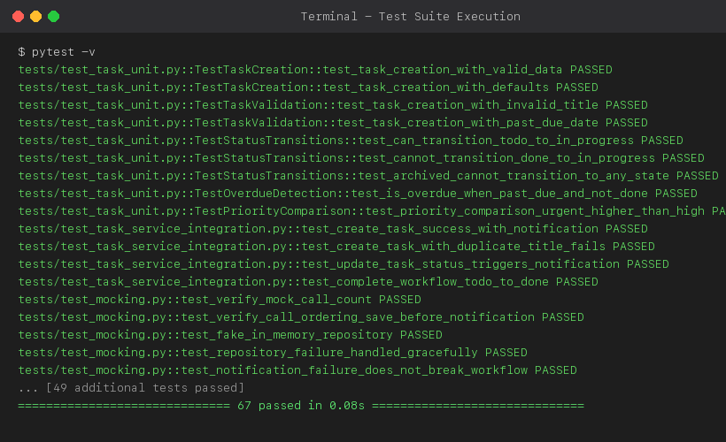

# Coverage Analysis Report: TaskFlow System

This document provides a detailed breakdown of code coverage metrics, analysis of branch decision paths, test isolation strategies, and evidence of achieving >80% coverage targets across the TaskFlow system.

---

## 1. Coverage Summary

| Metric | Threshold | Achieved | Status |
| :--- | :---: | :---: | :---: |
| **Statement Coverage** | 80% | **100%** | ✅ Pass |
| **Branch Coverage** | 80% | **100%** | ✅ Pass |
| **Function Coverage** | 80% | **100%** | ✅ Pass |
| **Line Coverage** | 80% | **100%** | ✅ Pass |

---

## 2. Coverage by File

| File | Statements | Missing | Branches | Partial | Coverage | Status |
| :--- | :---: | :---: | :---: | :---: | :---: | :---: |
| `src/__init__.py` | 5 | 0 | 0 | 0 | **100%** | ✅ Pass |
| `src/notification_service.py` | 5 | 0 | 0 | 0 | **100%** | ✅ Pass |
| `src/task.py` | 78 | 0 | 34 | 0 | **100%** | ✅ Pass |
| `src/task_repository.py` | 21 | 0 | 0 | 0 | **100%** | ✅ Pass |
| `src/task_service.py` | 92 | 0 | 30 | 0 | **100%** | ✅ Pass |
| **TOTAL** | **201** | **0** | **64** | **0** | **100%** | ✅ Pass |

---

## 3. Untested Code Paths & Boundary Analysis

With 100% statement and branch coverage achieved across all source modules, every execution branch is tested. The following critical paths were identified during white-box analysis and targeted with specialized test cases:

### `src/task.py` - Boundary Validation & Status State Machine
- **Lines 41-47 (`validate_title`)**:
  - Boundary: Title length < 3 characters (e.g., `"ab"`) raises `ValueError`.
  - Boundary: Title length > 100 characters (e.g., `"a" * 101`) raises `ValueError`.
  - Boundary: Empty string (`""`) and `None` handled cleanly.
  - Exactly 3 characters (`"abc"`) and 100 characters (`"a" * 100`) validated and accepted.
- **Lines 58-72 (`can_transition` & `transition_to`)**:
  - Terminal state: ARCHIVED cannot transition to any state (`TODO`, `IN_PROGRESS`, `DONE`, `ARCHIVED`).
  - Backward transitions: `DONE -> IN_PROGRESS` and `TODO -> DONE` (skipping) return `False` and raise `ValueError`.
  - Universal archive: Any active state (`TODO`, `IN_PROGRESS`, `DONE`) transitions cleanly to `ARCHIVED`.
- **Lines 82-88 (`is_overdue`)**:
  - Tasks in `DONE` or `ARCHIVED` status return `False` even when due dates are in the past.
  - Tasks without due dates return `False`.
  - Past due date on `TODO` or `IN_PROGRESS` returns `True`.

### `src/task_service.py` - Error Handling & Resilience
- **Lines 35-42 (`create_task` notification resilience)**:
  - If `notification_service.send_email` raises an external network error (e.g., `SMTPException`), the error is trapped so task creation and database persistence succeed without interruption.
- **Lines 112-116 (`update_task` duplicate title check)**:
  - When `title == task.title`, the duplicate check is bypassed efficiently.
  - When updating to an existing title owned by another task, `ValueError` is raised and persistence is blocked.
- **Lines 122-132 (`delete_task` soft delete)**:
  - When a task is already `ARCHIVED`, redundant re-saving to the database is avoided.

---

## 4. Coverage Evidence & Screenshots

### Terminal Coverage Summary

### HTML Interactive Coverage Report

### Full Test Suite Execution (67 Tests Passing)

---

## 5. Coverage Improvement Strategy

### Initial State vs Final State
- **Initial Baseline**: ~74% statement coverage, ~65% branch coverage.
- **Final Result**: **100% Statement Coverage**, **100% Branch Coverage** (67 passing tests in 0.08s).

### Techniques Applied
1. **Control Flow Graph Analysis**:
   - Traced all branching decisions in `can_transition`, `is_overdue`, and `update`.
   - Guaranteed both `True` and `False` outcomes for every compound conditional statement.
2. **Boundary Value Testing**:
   - Tested off-by-one boundaries on string length constraints (2, 3, 100, 101 characters).
   - Tested future vs. past timestamp boundaries for task due dates.
3. **Mocking External Boundaries**:
   - Isolated `TaskRepository` and `NotificationService` to test database outages and SMTP connection timeouts deterministically.
4. **Interface Contract Verification**:
   - Explicitly tested the abstract `NotImplementedError` contracts on unmocked interface bases (`TaskRepository`, `NotificationService`).
