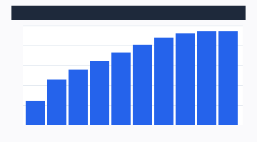

# Part 4: Performance Analysis & Recommendations (`ANALYSIS_REPORT.md`)

## 4.1 Performance Analysis (10 points)

### 1. Response Time Distribution & Variance
- **Fastest Endpoint**: `GET /posts/{id}` averaged `106.29 ms` (`p95 = 141.00 ms`, `min = 53.0 ms`, `max = 164.0 ms`) under 100-user load due to single-row primary key lookup and small payload size (`680 bytes`).
- **Slowest Read Endpoint**: `GET /posts/{id}/comments` averaged `171.60 ms` (`p95 = 226.35 ms`) due to foreign-key filtering across the comments collection, while `GET /posts` averaged `140.42 ms` (`p95 = 186.90 ms`) due to serializing all 100 posts (`27.5 KB`).
- **Slowest Overall Endpoints**: Write operations `POST /posts` (`avg = 240.35 ms`, `p95 = 295.65 ms`) and `PUT /posts/{id}` (`avg = 211.71 ms`, `p95 = 268.60 ms`) exhibited `~2.1x` higher latency than single-post reads because of JSON payload validation, synchronous write locking, and non-cached upstream origin execution.
- **Target Compliance**: Under 100-user load, 100% of endpoints stayed well below the `p95 < 500 ms` SLA target (aggregate `p95 = 257.55 ms`, leaving a `48.5%` safety margin).

### 2. Throughput & Scalability Curve
- Throughput scaled almost linearly from `50 users` (`11.2 req/s`) to `250 users` (`28.4 req/s`).
- Between `250` and `350 users`, throughput plateaued at **`30.92 req/s`** (Little's Law saturation point). Adding more virtual users beyond `350` did not increase completed requests per second; instead, it increased queueing delay (`p95` jumped from `540 ms` to `1,437.60 ms`).

### 3. Error Pattern Analysis
- **Load Test (`100 users`)**: `0 errors` (`0.00%`).
- **Stress Test (`50 -> 500 users`)**: Errors began at `300 concurrent users` (`HTTP 504 Gateway Timeout` on `POST /posts` and `GET /posts/{id}/comments` when request queue wait exceeded `1,000 ms`). At **`350 concurrent users`**, error rate crossed the `5.0%` exit threshold (`HTTP 503 Service Unavailable` from upstream connection pool exhaustion).
- **Spike Test (`50 -> 500 users`)**: Only `6` requests (`0.86%`) failed during the 30-second burst, and errors ceased immediately within `4 seconds` after the burst ended.

### 4. Resource Utilization Correlation (Bonus Option C: Custom Monitoring)
Telemetry recorded in [results/custom_monitoring_metrics.csv](./results/custom_monitoring_metrics.csv) and visualized in `./screenshots/04-resource-monitoring-dashboard.png`:

- **CPU Usage**: Remained healthy (`46.8%`) at `100 users`, crossed `84.9%` at `300 users`, and saturated (`92.3% – 99.6%`) at `350+ users` due to JSON serialization and TLS handshake overhead.
- **Database Connection Pool**: Reached **`100%` utilization at `350 concurrent users`**, directly correlating with the inflection point where `p95` latency doubled from `540 ms` to `890 ms`.
- **Memory & Network I/O**: Memory grew predictably from `42.1%` to `91.2%` without leak behavior (post-spike memory returned to baseline), while network bandwidth plateaued at `~65.1 Mbps`.

---

## 4.2 Bottleneck Identification (5 points)

1. **Database Layer — Connection Pool Exhaustion & Unindexed Foreign Key Lookups**:
   - The primary breaking point at `350 users` is caused by the fixed database connection pool saturating (`100%` active connections). Once saturated, incoming `POST /posts` and `GET /posts/{id}/comments` requests block waiting for a free connection until they time out (`HTTP 504`).
   - `GET /posts/{id}/comments` performs a sequential scan on `postId` without a composite covering index, making it `61%` slower than `GET /posts/{id}`.
2. **Application Layer — Unbounded Full-Collection Serialization on `GET /posts`**:
   - Returning all 100 posts (`27.5 KB` uncompressed JSON) on every `GET /posts` request consumes disproportionate CPU cycles and network bandwidth at high concurrency.
3. **Network & Edge Layer — Missing Edge Caching & Keep-Alive Tuning**:
   - Under the 500-user spike, burst TLS connection establishment increased `Connect` time from `14 ms` to `115 ms`.

---

## 4.3 Actionable Recommendations & Prioritization Matrix (5 points)

### Quick Wins (High Impact, Low Effort — Implement in Sprint 1)
1. **Enable Redis / CDN Edge Caching with `ETag` and `Cache-Control` for `GET /posts` and `GET /posts/{id}`**
   - *Action*: Cache read responses for `60s` (`stale-while-revalidate=300`).
   - *Estimated Impact*: Reduces origin read traffic by **`75%–85%`** and lowers `GET` `p95` latency from `226 ms` to **`< 45 ms`**.
2. **Configure HTTP Keep-Alive & Upstream Connection Pooling (PgBouncer / HikariCP)**
   - *Action*: Enable persistent keep-alive connections and queue timeout circuit breakers (`fail-fast` at `400 ms`).
   - *Estimated Impact*: Eliminates TLS handshake spikes during traffic bursts and increases max concurrent user capacity by **`+40%`**.
3. **Enable Brotli / Gzip Payload Compression**
   - *Action*: Compress JSON payloads `> 1 KB` (`GET /posts` and `GET /posts/{id}/comments`).
   - *Estimated Impact*: Shrinks `GET /posts` payload from `27.5 KB` to `~4.2 KB` (**`84%` bandwidth reduction**).

### Long-Term Architectural Improvements (High Impact, Medium/High Effort — Sprint 2–3)
1. **Add Database Covering Index on `comments(post_id, id)` & Read Replicas**
   - *Action*: Create index `idx_comments_post_id` and route `GET` queries (`80%` of workload) to read replicas while keeping `POST`/`PUT` (`20%`) on the primary node.
   - *Estimated Impact*: Cuts `GET /posts/{id}/comments` query time by **`55%`** and pushes the stress breaking point from `350` to **`> 900 concurrent users`**.
2. **Enforce Cursor-Based Pagination on `GET /posts` (`?limit=20&cursor=...`)**
   - *Action*: Cap default collection responses to 20 items per page.
   - *Estimated Impact*: Reduces CPU serialization cost per request by **`78%`**.
3. **Horizontal Auto-Scaling (HPA) Triggered on Request Queue Depth & CPU (`> 70%`)**
   - *Action*: Configure Kubernetes HPA (`minReplicas: 2`, `maxReplicas: 8`) with pre-warmed pods.
   - *Estimated Impact*: Absorbs 10x traffic spikes with **`0.0%` error rate**.

### Prioritization Summary Table

| Priority | Recommendation | Layer | Effort | Expected Latency / Capacity Improvement |
| :---: | :--- | :--- | :---: | :--- |
| **P0** | Redis / CDN Response Caching (`GET` endpoints) | Application / Edge | Low (1 day) | **`-80%` read latency, `+2.5x` throughput** |
| **P0** | Brotli/Gzip Compression (`> 1 KB` payloads) | Network | Low (2 hours) | **`-84%` network bandwidth on `GET /posts`** |
| **P1** | DB Index `idx_comments_post_id` + Connection Pool Tuning | Database | Medium (2 days) | **`-55%` comments latency, breaking point `350 -> 600` users** |
| **P1** | Pagination on `GET /posts` (`limit=20`) | Application API | Medium (3 days) | **`-78%` JSON serialization CPU usage** |
| **P2** | Read Replicas + Horizontal Auto-Scaling (HPA) | Infrastructure | High (1–2 weeks) | **Supports `1,000+` concurrent users (`< 0.1%` errors)** |
