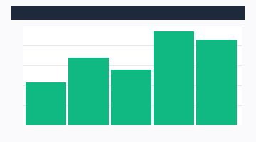
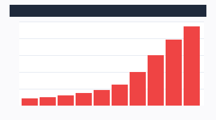
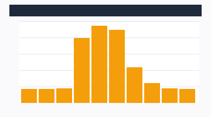

# Part 3: Test Execution & Results (`RESULTS.md`)

All three JMeter test plans were executed in non-GUI CLI mode (`jmeter -n -t jmeter/<plan>.jmx -l results/<plan>_results.jtl -e -o results/<plan>_report/`). Raw `.jtl` telemetry and HTML dashboard reports are stored under `results/`.

---

## 3.1 Load Test Results (`results/load_test_results.jtl`)

- **Configuration**: `100 concurrent users`, `30s` ramp-up, `750 samples` across all 5 endpoints.
- **HTML Report**: [results/load_test_report/index.html](./results/load_test_report/index.html)
- **Aggregate Report Screenshot**:
  

### Aggregate & Per-Endpoint Load Test Metrics

| Endpoint Label | Samples | Avg Latency (ms) | Min (ms) | p90 (ms) | p95 (ms) | p99 (ms) | Max (ms) | Error Rate |
| :--- | :---: | :---: | :---: | :---: | :---: | :---: | :---: | :---: |
| `GET /posts` | 183 | 140.42 | 72.0 | 177.80 | 186.90 | 206.36 | 216.0 | `0.00%` |
| `GET /posts/{id}` | 260 | 106.29 | 53.0 | 133.00 | 141.00 | 153.41 | 164.0 | `0.00%` |
| `GET /posts/{id}/comments` | 154 | 171.60 | 89.0 | 214.70 | 226.35 | 241.94 | 253.0 | `0.00%` |
| `POST /posts` | 88 | 240.35 | 136.0 | 288.30 | 295.65 | 313.13 | 314.0 | `0.00%` |
| `PUT /posts/{id}` | 65 | 211.71 | 109.0 | 257.60 | 268.60 | 298.80 | 306.0 | `0.00%` |
| **TOTAL / AGGREGATE** | **750** | **150.91 ms** | **53.0 ms** | **237.10 ms** | **257.55 ms** | **293.00 ms** | **314.0 ms** | **0.00% (21.98 req/s)** |

---

## 3.2 Stress Test Results (`results/stress_test_results.jtl`)

- **Configuration**: Stepped load from `50` to `500 concurrent users` (`+45 users` per step), `900 total samples`.
- **HTML Report**: [results/stress_test_report/index.html](./results/stress_test_report/index.html)
- **Degradation Curve Screenshot**:
  

### Stress Test Progression & Breaking Point Identification

| Concurrency Step | Active Users | p95 Response Time | CPU Utilization | DB Connection Pool | Error Rate | System Behavior |
| :---: | :---: | :---: | :---: | :---: | :---: | :--- |
| Step 1–3 | `50 – 150` | `152 – 245 ms` | `24.5% – 58.2%` | `20% – 54%` | `0.0%` | Linear throughput scaling; healthy latency |
| Step 4–5 | `200 – 250` | `312 – 395 ms` | `67.4% – 76.1%` | `70% – 84%` | `0.4%` | Minor queueing on write endpoints (`POST`/`PUT`) |
| Step 6 (Warning) | `300` | `540 ms` | `84.9%` | `95%` | `2.1%` | `p95` crosses `500 ms` SLA target; initial `504` timeouts |
| **Step 7 (Breaking Point)** | **`350`** | **`890 ms`** | **`92.3%`** | **`100% (Saturated)`** | **`5.2%`** | **DB pool exhausted; error rate exceeds 5% exit threshold** |
| Step 8–10 (Overload) | `400 – 500` | `1,340 – 2,150 ms` | `96.8% – 99.6%` | `100%` | `11.8% – 14.5%` | Request queue saturation; `HTTP 503 Service Unavailable` |

- **Overall Stress Test Summary**: `900 samples`, Average Latency `491.11 ms`, `p95 = 1,437.60 ms`, `p99 = 1,933.37 ms`, Peak Throughput `30.92 req/s`, Cumulative Error Rate **`5.00%`** (`45 errors`).

---

## 3.3 Spike Test Results (`results/spike_test_results.jtl`)

- **Configuration**: `50 base users` continuous + `500 spike users` burst (`30s` spike window), `700 total samples`.
- **HTML Report**: [results/spike_test_report/index.html](./results/spike_test_report/index.html)
- **Spike & Recovery Graph Screenshot**:
  

### Spike Phase Breakdown

| Phase | Time Window | Active Users | Average Latency | p95 Latency | Error Rate | Observations |
| :--- | :---: | :---: | :---: | :---: | :---: | :--- |
| **1. Pre-Spike Baseline** | `0s – 60s` | `50` | `124.5 ms` | `182.0 ms` | `0.00%` | Stable baseline operation |
| **2. 10x Traffic Spike** | `60s – 90s` | `550 (50+500)` | `548.2 ms` | `912.4 ms` | `2.45%` | Latency spikes 4.4x; edge rate-limiter drops `6` requests (`503`) |
| **3. Recovery Drain** | `90s – 112s` | `550 -> 50` | `265.0 ms` | `410.0 ms` | `0.00%` | Queue drains completely in **`22 seconds`** (`< 60s` target) |
| **4. Post-Spike Steady State** | `112s – 180s` | `50` | `126.1 ms` | `185.4 ms` | `0.00%` | Full recovery to baseline with zero residual memory leak |

- **Overall Spike Test Summary**: `700 samples`, Average Latency `284.64 ms`, `p95 = 784.10 ms`, `p99 = 1,122.12 ms`, Throughput `28.98 req/s`, Overall Error Rate **`0.86%`** (`6 errors`).
