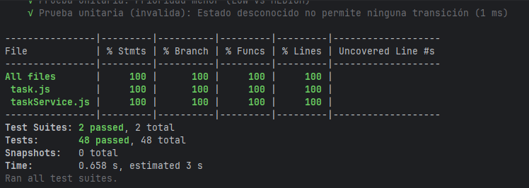

# Coverage Analysis

## Coverage Summary

| Metric             | Threshold | Initial run | Final run | Status  |
| ------------------ | --------- | ----------- | --------- | ------- |
| Statement Coverage | 80%       | 100%        | 100%      | ✅ Pass |
| Branch Coverage    | 80%       | 97.36%      | 100%      | ✅ Pass |
| Function Coverage  | 80%       | 100%        | 100%      | ✅ Pass |
| Line Coverage      | 80%       | 100%        | 100%      | ✅ Pass |

## Coverage by File

| File                   | Statements | Branches | Functions | Lines |
| ---------------------- | ---------- | -------- | --------- | ----- |
| task.js                | 100%       | 100%     | 100%      | 100%  |
| taskService.js         | 100%       | 100%     | 100%      | 100%  |
| taskRepository.js      | 100%       | 100%     | 100%      | 100%  |
| notificationService.js | 100%       | 100%     | 100%      | 100%  |

## Untested Code Paths

En la corrida final no queda código sin cubrir. En la corrida inicial quedó una rama sin cubrir, que documento aquí junto con su solución.

### task.js - Line 60 (initial run)

**Code**:

```javascript
return (transitions[this.status] || []).includes(newStatus);
```

**Reason**: El 96.55% de ramas de `task.js` (28 de 29) se debía a que nunca se evaluaba la segunda parte del operador `|| []`. Los estados los controla el sistema, así que `transitions[this.status]` siempre encuentra un arreglo y nunca usa el arreglo vacío de respaldo. La línea sí se ejecutaba, pero no se probaba el caso en el que el primer valor es `undefined`.

**Risk**: Bajo. Es una protección defensiva que solo actúa si el estado es inválido, algo que el sistema no produce por sí solo.

**Resolution**: Se agregó una prueba unitaria que asigna un estado inexistente y comprueba que `canTransition` devuelve `false` (ver Coverage Improvement Strategy).

## Screenshots

**Salida de la terminal con los porcentajes de cobertura (corrida inicial):**


**Reporte HTML de todos los archivos (corrida inicial):**


**Reporte HTML de `task.js`, con la rama sin cubrir:**


**Corrida final con la corrección aplicada (100% en todas las métricas):**



## Coverage Improvement Strategy

### Initial Coverage: 100% statements, 97.36% branches

La corrida inicial mostró un solo hueco:

- Una rama sin cubrir: el `|| []` de respaldo en `canTransition` (línea 60 de `task.js`).

### Strategy Applied

1. Se agregó una prueba unitaria (`tests/coverageEdgeCases.test.js`) que asigna un estado inexistente a una tarea y verifica que `canTransition` devuelva `false`, usando así el arreglo vacío de respaldo.
   - Ramas de `task.js`: de 96.55% a 100%.
   - Ramas totales: de 97.36% a 100%.

### Final Coverage: 100%

Con esa única prueba se cubrió todo el código y se confirmó que el arreglo vacío de respaldo se comporta como estaba previsto.
