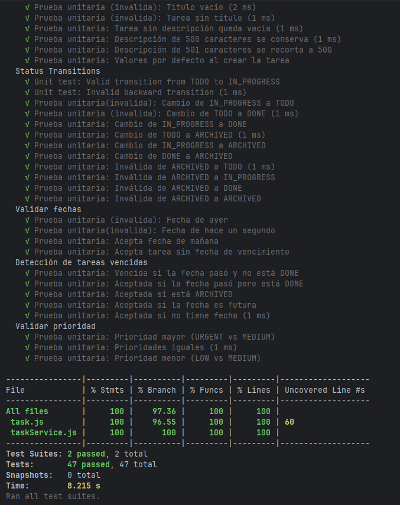
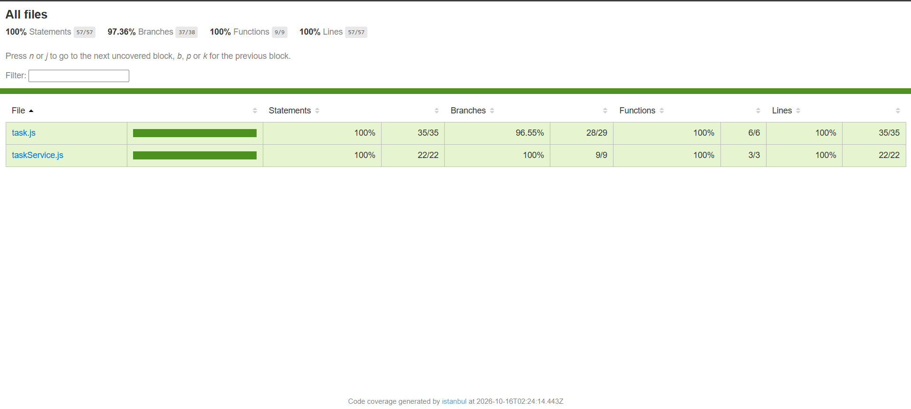
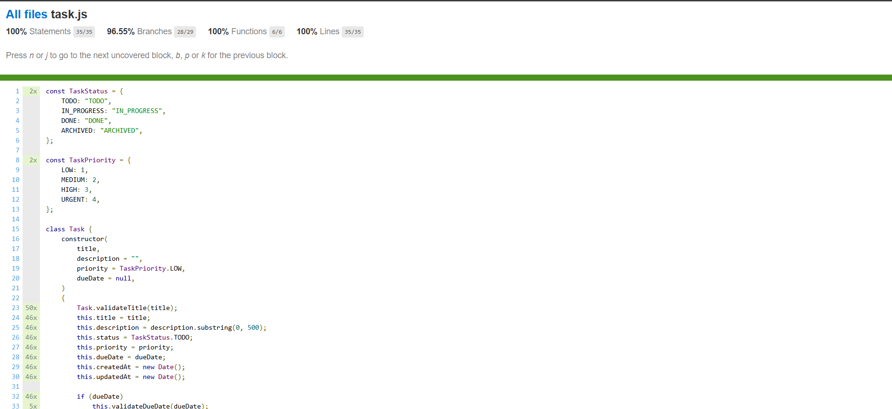
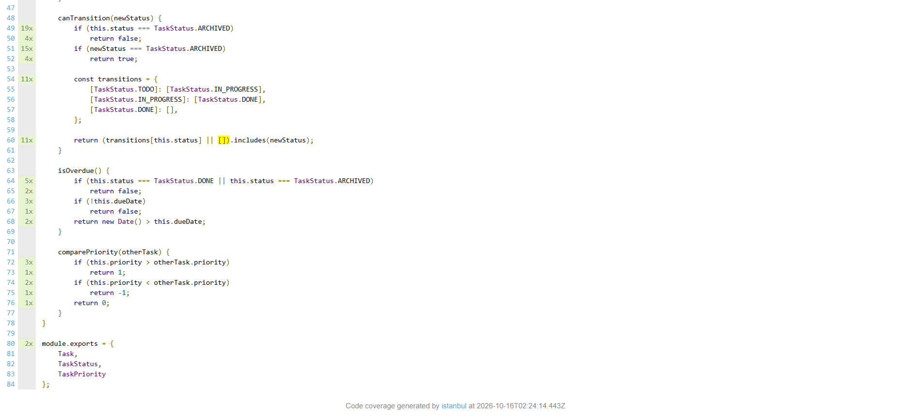

## Coverage Summary

| Metric             | Threshold | Achieved | Status |
|--------------------|-----------|----------|--------|
| Statement Coverage | 80%       | 100%     | ✅ Pass |
| Branch Coverage    | 80%       | 97.36%   | ✅ Pass |
| Function Coverage  | 80%       | 100%     | ✅ Pass |
| Line Coverage      | 80%       | 100%     | ✅ Pass |

## Coverage by File

| File           | Statements | Branches | Functions | Lines |
|----------------|------------|----------|-----------|-------|
| task.js        | 100%       | 96.55%   | 100%      | 100%  |
| taskService.js | 100%       | 100%     | 100%      | 100%  |

## Untested Code Paths

### task.js - Línea 60

**Code**:

```JavaScript
return (transitions[this.status] || []).includes(newStatus);
```
Motivo
El 96.55% de cobertura en ramas (branches) se debe a que el programa nunca evalúa la segunda parte del operador || []. Dado que los estados están controlados por el sistema, transitions[this.status] siempre encuentra un arreglo válido y nunca llega a utilizar el arreglo vacío de respaldo. Esto significa que la línea de código sí se ejecuta, pero nunca se llega a probar el caso donde el primer resultado es inválido o indefinido.

Riesgo
Bajo - No representa ningún problema real, ya que superamos con creces el estándar del 80% requerido en la revisión de ramas. Además, no es un punto crítico, sino una contramedida defensiva por si llegara a fallar.

**3. Screenshots**:
**Salida de la terminal con los porcentajes de cobertura:**


**Reporte HTML de todos los archivos:**


**Reporte HTML de task.js, con la rama sin cubrir:**



**4. Coverage Improvement Strategy**:

```markdown
## How Coverage Goals Were Achieved

### Initial Coverage: 92%%

Initial test run showed gaps in:
- Un tipo de resultado sin cubrir

### Strategy Applied

1. Prueba de integracion que valide que si regrese una lista basia
   - Improved validation coverage from 92% to 100%

### Final Coverage: 100%

Añadir una pruba mas para poder validar todo el codigo y ver que la contencion con la lista basi si se haga como esta prevista.
