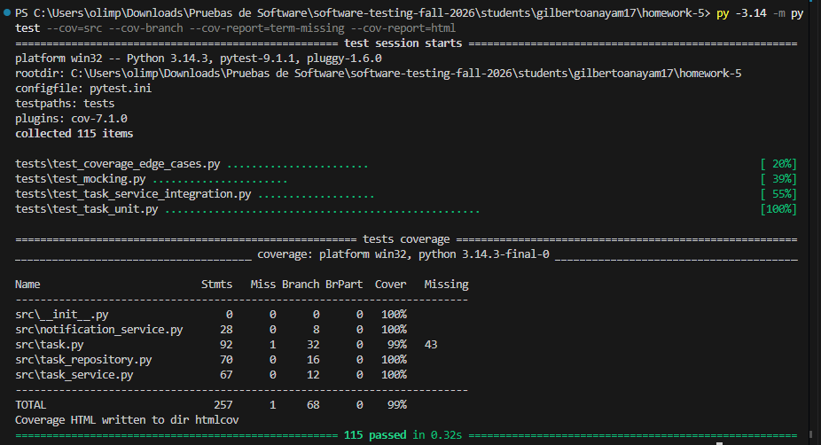
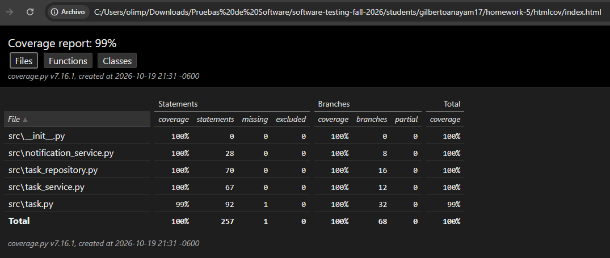
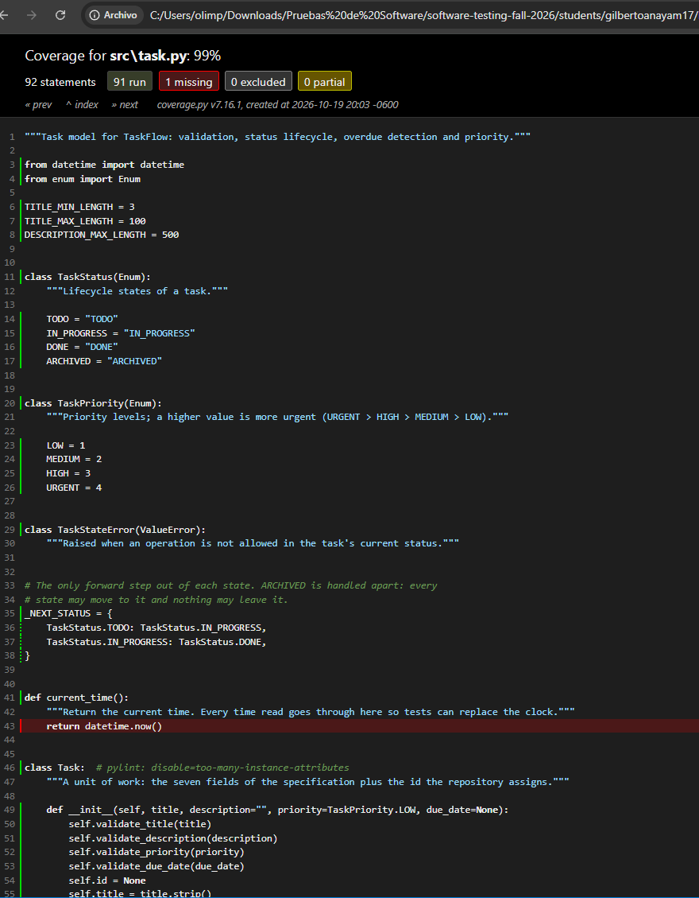

# Coverage Analysis: TaskFlow

Medido con pytest 9.1, pytest-cov 7.1 y coverage.py 7.16, con `--cov=src --cov-branch`. Todas las cifras salen de `coverage.json`; el HTML redondea a enteros.

## Coverage Summary

| Metric             | Threshold | Achieved         | Status  |
| ------------------ | --------- | ---------------- | ------- |
| Statement Coverage | 80%       | 99.61% (256/257) | ✅ Pass |
| Branch Coverage    | 80%       | 100.00% (68/68)  | ✅ Pass |
| Function Coverage  | 80%       | 97.78% (44/45)   | ✅ Pass |
| Line Coverage      | 80%       | 99.61% (256/257) | ✅ Pass |

## Coverage by File

| File                    | Statements    | Branches     | Functions     | Lines         | Combined |
| ----------------------- | ------------- | ------------ | ------------- | ------------- | -------- |
| task.py                 | 98.9% (91/92) | 100% (32/32) | 91.7% (11/12) | 98.9% (91/92) | 99.2%    |
| task_service.py         | 100% (67/67)  | 100% (12/12) | 100% (13/13)  | 100% (67/67)  | 100%     |
| task_repository.py      | 100% (70/70)  | 100% (16/16) | 100% (16/16)  | 100% (70/70)  | 100%     |
| notification_service.py | 100% (28/28)  | 100% (8/8)   | 100% (4/4)    | 100% (28/28)  | 100%     |

## Untested Code Paths

### task.py, line 43

```python
def current_time():
    """Return the current time. Every time read goes through here so tests can replace the clock."""
    return datetime.now()
```

**Reason**: es la costura por donde se inyecta el reloj. Un fixture `autouse` en `conftest.py` la reemplaza por un `FakeClock` en todas las pruebas, justamente para que ningún resultado dependa de la hora en que corre la suite. Cubrir esta línea obligaría a comparar contra el reloj real, que es la fuente de no determinismo que el diseño elimina, y lo único que se estaría probando es `datetime.now()` de la biblioteca estándar.

**Risk**: Muy bajo. Es una delegación de una línea sin lógica, y producción la ejecuta en cada creación, actualización y revisión de vencimiento.

## Screenshots

**Terminal: resumen de cobertura** (`term-missing` muestra la línea 43 como la única pendiente)



**Reporte HTML: índice por archivo**



**Reporte HTML: `task.py` con la línea sin cubrir resaltada en rojo**



**Ejecución completa con `pytest -v`:** [test-execution.png](screenshots/test-execution.png)

## How Coverage Goals Were Achieved

### Initial Coverage: 59.08%

Medí la cobertura después de cada archivo de pruebas, siempre con la suite completa del paso anterior:

| Step                            | Tests | Combined | Statements | Branches | Functions |
| ------------------------------- | ----- | -------- | ---------- | -------- | --------- |
| 1. Unit tests (`Task`)          | 51    | 59.08%   | 62.65%     | 45.59%   | 35.56%    |
| 2. + Integration tests          | 70    | 88.31%   | 89.49%     | 83.82%   | 88.89%    |
| 3. + Mocking tests              | 92    | 97.85%   | 98.44%     | 95.59%   | 97.78%    |
| 4. + Edge cases from the report | 115   | 99.69%   | 99.61%     | 100.00%  | 97.78%    |

### Strategy Applied

1. **El modelo primero.** Las pruebas unitarias dejaron `task.py` en 98.9% de sentencias desde el inicio, pero la cifra global era 59% porque servicio, repositorio y notificaciones no se ejecutaban. El reporte marcó una rama parcial (`117->119`): todas las pruebas de `update` cambiaban el título, así que nunca se tomó el camino "sin título". Las líneas estaban cubiertas y la rama no.
2. **Integración con un fake.** Conectar el servicio al `TaskRepository` real sobre `FakeDatabase` subió la cobertura a 88%, porque cada flujo (crear → actualizar → completar, archivar, purgar, buscar) atraviesa las tres capas.
3. **Dobles en las fronteras.** `notification_service.py` seguía en 28% porque el servicio siempre lo usa como mock. Probarlo contra un cliente HTTP simulado, y provocar con `side_effect` las ramas que traducen errores (`OSError` → `NotificationError`, `DatabaseError` → `RepositoryError`), llevó la cobertura a 97.85%.
4. **Leer `term-missing` y apuntar.** Quedaban `task_repository.py` 57 y 75 (rango de fechas invertido, fecha antes del inicio), `task_service.py` 71 (purgar una tarea activa) y la línea 43. Cada prueba de `test_coverage_edge_cases.py` nombra la rama o el límite que cubre.
5. **Verificar con mutación.** Con la cobertura ya alta, la mutación encontró el único límite que faltaba (HTTP 400).

### Final Coverage: 99.69%

El paso 4 agregó 23 pruebas: 22 salieron del reporte y 1 de la mutación. La única línea que falta está justificada arriba.
