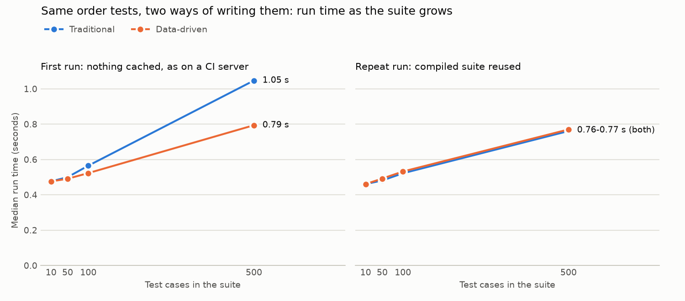

# Performance Report - Traditional vs Data-Driven (Bonus B)

La pregunta de este reporte es si sacar los datos del código cuesta tiempo de ejecución. Para responderla medí las mismas pruebas de pedidos escritas de las dos formas, con 10, 50, 100 y 500 casos.

## Method

El script `scripts/compare_performance.py` hace todo el experimento en cuatro pasos.

1. Toma los 25 casos de `order_calculations.csv` y los repite hasta completar el tamaño pedido.
2. Escribe dos suites equivalentes en una carpeta temporal. La **Traditional** tiene una función de prueba por caso, con los datos en el código, mientras que la **Data-driven** tiene una sola función parametrizada que lee los casos de un CSV con el mismo loader que usa la tarea.
3. Corre cada suite en un proceso nuevo de pytest y mide el tiempo total del proceso, que es lo que espera quien corre las pruebas (arrancar Python y pytest, recolectar, ejecutar y reportar).
4. Repite cada medición 7 veces, alternando las dos formas, y se queda con la mediana.

Medí dos situaciones, ya que responden preguntas distintas.

- **First run** es cuando se borra el bytecode de la suite antes de cada corrida. Es lo que pasa en un servidor de CI, que siempre parte de un checkout limpio.
- **Repeat run** es cuando Python y pytest reutilizan la suite ya compilada. Es lo que pasa al volver a correr las pruebas en la máquina de quien desarrolla.

El entorno fue Windows 11, Python 3.14.3 y pytest 9.1.1.

## Results

La tabla muestra la mediana de 7 corridas, en segundos. La tabla completa, con mínimos y máximos, está en `performance/results.csv`.

| Casos | First run (Traditional) | First run (Data-driven) | Repeat run (Traditional) | Repeat run (Data-driven) | Líneas de prueba (Traditional) | Líneas de prueba (Data-driven) |
| ----- | ----------------------- | ----------------------- | ------------------------ | ------------------------ | ------------------------------ | ------------------------------ |
| 10    | 0.476                   | 0.476                   | 0.461                    | 0.461                    | 76                             | 14                             |
| 50    | 0.500                   | 0.491                   | 0.481                    | 0.492                    | 379                            | 14                             |
| 100   | 0.565                   | 0.523                   | 0.522                    | 0.532                    | 757                            | 14                             |
| 500   | 1.047                   | 0.794                   | 0.761                    | 0.770                    | 3,781                          | 14                             |



## Analysis

**El costo fijo domina en suites chicas.** Con 10 casos las dos formas tardan lo mismo (0.48 s), y casi todo ese tiempo se va en arrancar Python y pytest. Hasta 50 casos la diferencia entre ambas es de alrededor de 0.01 s.

**En la primera corrida, la versión tradicional crece casi al doble de rápido.** Entre 10 y 500 casos, cada caso adicional le cuesta 1.17 ms a la versión tradicional y 0.65 ms a la data-driven. Con 500 casos la tradicional tarda 1.05 s contra 0.79 s, es decir, 0.25 s más (un 32%). La causa es el tamaño del archivo de pruebas, ya que pytest tiene que leer, reescribir los `assert` y compilar 3,781 líneas de Python, mientras que la versión data-driven compila 14 líneas y lee 500 filas con el módulo `csv`, que es mucho más barato. Esto lo confirma el hecho de que la diferencia desaparece cuando la suite ya está compilada.

**En corridas repetidas no hay diferencia.** Con la suite ya compilada, las dos líneas de la gráfica se enciman (0.76 s y 0.77 s con 500 casos). En ambas, cada caso adicional cuesta unos 0.6 ms, que es lo que tarda pytest en ejecutar y reportar una prueba. La versión data-driven queda unos 0.01 s arriba de 50 casos en adelante, ya que vuelve a leer y convertir el CSV en cada corrida, pero esa diferencia es menor que la variación entre corridas de una misma suite (para la tradicional de 500 casos, de 0.75 s a 0.98 s).

**Conclusión.** Considero que el tiempo de ejecución no es una razón para elegir una forma u otra, ya que en el peor escenario medido la diferencia es de un cuarto de segundo y además favorece a la versión data-driven. La razón para elegir sigue siendo el mantenimiento, y ahí las últimas dos columnas de la tabla son las que importan, porque con 500 casos la versión tradicional son 3,781 líneas de código de prueba y la data-driven sigue siendo de 14, más un CSV de 500 filas.

## Limitations

- Las pruebas medidas son muy rápidas (un cálculo en memoria). Con pruebas que usan red o base de datos, el tiempo de cada prueba dominaría y la forma de escribirlas importaría todavía menos.
- Los casos de 50 a 500 repiten los mismos 25 pedidos, lo que sirve para medir el costo de la estructura pero no agrega cobertura.
- Los tiempos absolutos dependen de la máquina. Lo que debería sostenerse al repetir el experimento es la forma de las curvas, no los valores exactos.

## Reproducing

```bash
python scripts/compare_performance.py               # mide y regenera results.csv y la gráfica (entre 1 y 2 minutos)
python scripts/compare_performance.py --chart-only  # solo redibuja la gráfica desde results.csv
```
