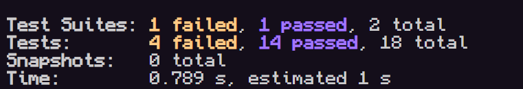
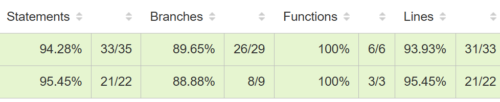

Tests 14 passed, 4 failed: 
Coverage Passed: 

•
What was most challenging about achieving high coverage?
nothign really, I already needed to study the requirements deeply with notes and by reading multiple times, making diverse tests was easy because I had notes per service and for reach service the requirements
•
How does white box testing differ from black box testing?
I get to see the code and test the internal structure, meaning I get to study classes, function and mocks and not just outputs and inputs of the whole app
•
Will you use code coverage in your future projects?
of course, it is the easiest way to tell that the tests can be trusted