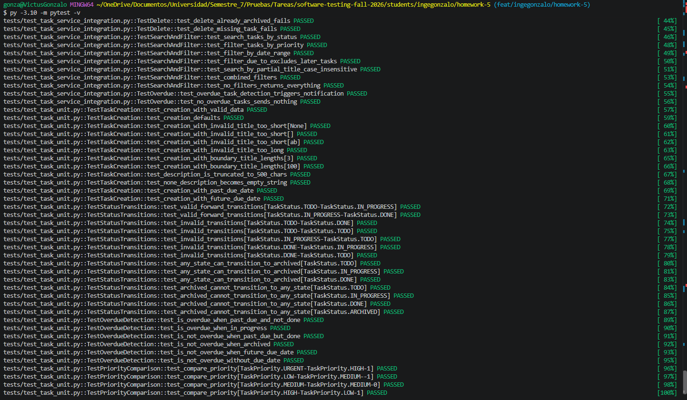
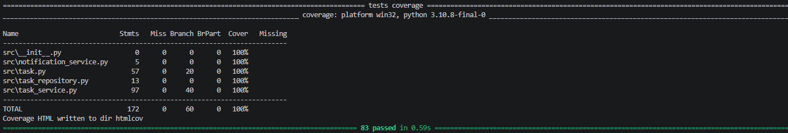
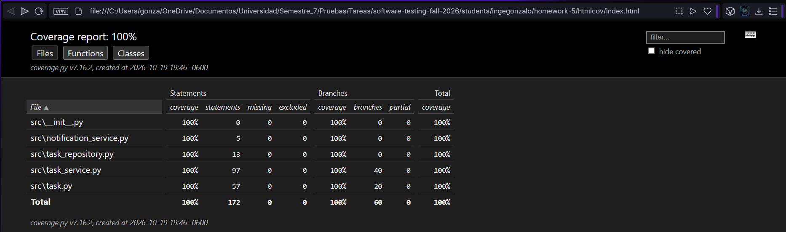

# Coverage Analysis

## Coverage Summary

| Metric             | Threshold | Achieved | Status  |
| ------------------ | --------- | -------- | ------- |
| Statement Coverage | 80%       | 100%     | ✅ Pass |
| Branch Coverage    | 80%       | 100%     | ✅ Pass |
| Function Coverage  | 80%       | 100%     | ✅ Pass |
| Line Coverage      | 80%       | 100%     | ✅ Pass |

Totals: 172 statements (0 missed) and 60 branches (0 partial), measured with `pytest --cov=src --cov-branch`. The full suite has 83 tests and runs in under 1 second.

## Coverage by File

| File                    | Statements | Branches | Functions | Lines |
| ----------------------- | ---------- | -------- | --------- | ----- |
| task.py                 | 100% (57)  | 100% (20) | 100%     | 100%  |
| task_service.py         | 100% (97)  | 100% (40) | 100%     | 100%  |
| task_repository.py      | 100% (13)  | n/a (0)  | 100%      | 100%  |
| notification_service.py | 100% (5)   | n/a (0)  | 100%      | 100%  |
| __init__.py             | n/a (0)    | n/a (0)  | n/a       | n/a   |

## Untested Code Paths

There are no uncovered statements or branches: the "Missing" column of the coverage report is empty for every file.

Two clarifications about what the 100% means:

- **Interface methods** in `task_repository.py` and `notification_service.py` only raise `NotImplementedError`. They are covered by tests in `test_coverage_edge_cases.py` that confirm the interfaces must be mocked. These tests raise coverage but verify little behavior, so I consider them low-value, even though they are cheap and harmless.
- **Notification failure handling** in `TaskService._safe_send` (the `logger.warning` path) is covered by tests that make `send_email` and `send_sms` raise exceptions via `side_effect`.

Risk: Very low. Coverage shows that every line and branch was executed, not that every behavior is verified. Real infrastructure failures (an actual database or SMTP server going down) are not exercised here and belong in system or end-to-end tests.

## How Coverage Goals Were Achieved

### Initial Coverage: 45%

The first run, with only the unit tests of the `Task` model, covered the model but left `TaskService` and the interfaces untested.

### Strategy Applied

1. **Boundary value tests** for title length (0, 2, 3, 100 and 101 characters) and for description truncation at 500 characters.
2. **Parametrized transition tests** covering every valid, invalid and ARCHIVED transition with a few lines of code.
3. **Negative tests for every business rule**: duplicate titles, past due dates, invalid transitions, missing tasks and modifying archived tasks.
4. **Mocked dependencies with `side_effect`** to simulate database and notification failures, so that error paths could be tested without real infrastructure.
5. **Filter combinations** in `search_tasks` (status, priority, date range, partial title and combined filters) to cover every branch of the search logic.
6. **Interface tests** for the `NotImplementedError` methods of the repository and notification service.

### Final Coverage: 100%

The suite grew to 83 tests (36 unit, 26 integration, 10 mocking and 11 edge case tests). Statement and branch coverage both reached 100%, with the whole suite running in under 1 second.

## Screenshots

