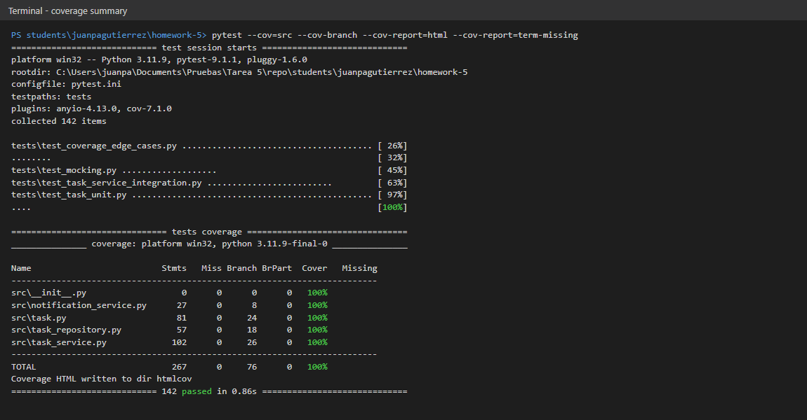
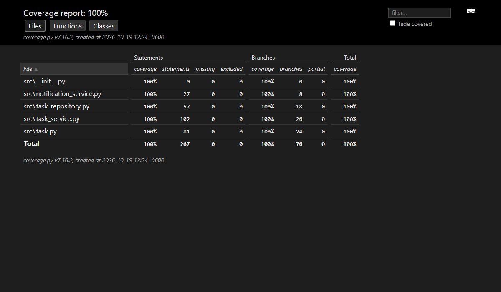
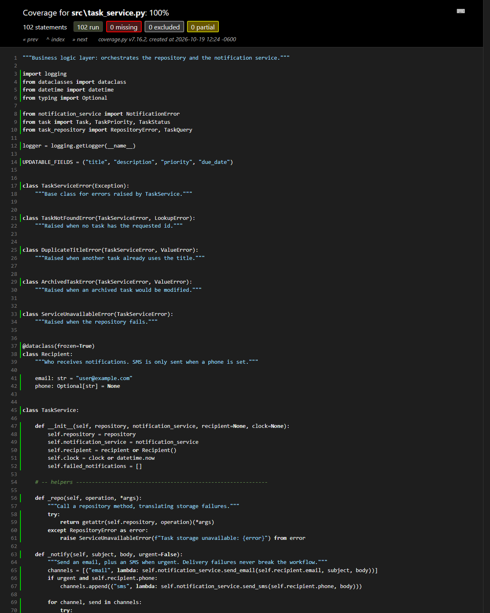
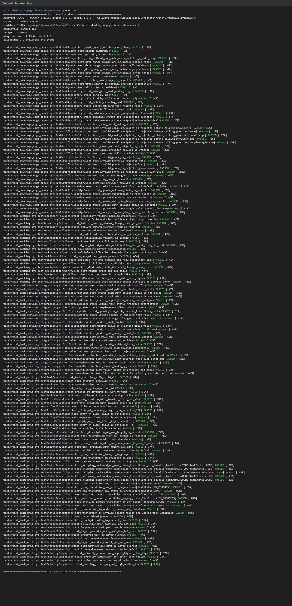

# Coverage Analysis - TaskFlow

Coverage was measured with coverage.py 7.16 through pytest-cov, with branch
coverage enabled (the same mode the grading system uses):

```bash
pytest --cov=src --cov-branch --cov-report=html --cov-report=term-missing
```

## Coverage Summary

| Metric             | Threshold | Achieved          | Status  |
| ------------------ | --------- | ----------------- | ------- |
| Statement Coverage | 80%       | 100% (267/267)    | ✅ Pass |
| Branch Coverage    | 80%       | 100% (76/76)      | ✅ Pass |
| Function Coverage  | 80%       | 100% (39/39)      | ✅ Pass |
| Line Coverage      | 80%       | 100%              | ✅ Pass |

Function coverage counts every `def` in `src/` (39), read from the
"Functions" tab of the HTML report.

## Coverage by File

| File                      | Statements | Branches | Functions | Lines |
| ------------------------- | ---------- | -------- | --------- | ----- |
| `task.py`                 | 100% (81)  | 100% (24) | 100% (12) | 100% |
| `task_service.py`         | 100% (102) | 100% (26) | 100% (13) | 100% |
| `task_repository.py`      | 100% (57)  | 100% (18) | 100% (11) | 100% |
| `notification_service.py` | 100% (27)  | 100% (8)  | 100% (3)  | 100% |

## Screenshots

| Screenshot | Shows |
| ---------- | ----- |
|  | Terminal `term-missing` report: every file at 100%, no missing lines or partial branches |
|  | HTML report index with statement and branch columns |
|  | Line-level view of `task_service.py`: 102 run, 0 missing, 0 partial |
|  | `pytest -v` run: all 142 tests passing |

## Untested Code Paths

**There are no uncovered statements or branches**, and no `# pragma: no cover`
exclusions were used to get there. Every path is reached by a test that asserts
on its outcome, not just executed.

Full coverage does not mean everything is verified, though. These are the
risks the coverage number cannot see, and why they are left out:

### 1. Real database and provider clients

**Code**: `TaskRepository._call` and `NotificationService.send_email` / `send_sms`
call `self.database.*`, `self.email_client.send` and `self.sms_client.send`.

**Reason**: Only mocks are used for those clients, so the tests prove the
wrappers translate *any* client exception into `RepositoryError` /
`NotificationError`, but not that a real driver behaves the way the mock
assumes (for example, whether `get` returns `None` or raises for a missing key).
That needs contract or end-to-end tests against the real services.

**Risk**: Medium - the mock encodes an assumption about an interface we do not own.

### 2. Concurrent duplicate titles

**Code**:

```python
def _ensure_title_available(self, title, task_id=None):
    existing = self._repo("find_by_title", title)
    if existing is not None and existing.id != task_id:
        raise DuplicateTitleError(...)
```

**Reason**: Both branches are covered, but the check and the later `save` are
two separate calls. Two concurrent requests could both pass the check. The
proper fix is a unique constraint in the database, which is outside a unit or
integration test with mocks.

**Risk**: Low for a single-user system, real for a multi-user deployment.

### 3. Timezone-aware dates

**Reason**: All tests use naive `datetime` values from a fixed clock. Mixing a
timezone-aware `due_date` with the naive default clock would raise `TypeError`
on comparison. This is documented rather than tested because the system is
specified with naive local times.

**Risk**: Low.

## How Coverage Goals Were Achieved

The suites were written in order and coverage was measured after each one.
"Combined" is coverage.py's total with `--cov-branch`:
(covered statements + covered branches) / (statements + branches).

| Stage | Suites run | Tests | Combined coverage | Main gaps reported |
| ----- | ---------- | ----- | ----------------- | ------------------ |
| 1 | unit | 52 | **50%** | `task.py` 100%, but repository 32%, notifications 26%, service 25% |
| 2 | + integration | 77 | **76%** | service 95%; repository and notification layers still only reached through mocks |
| 3 | + mocking | 96 | **90%** | 11 partial branches: query filters, validation errors, `delete` of a missing task |
| 4 | + edge cases | 142 | **100%** | none |

### Initial Coverage: 50%

The first run (unit tests only) left all of `task_service.py`,
`task_repository.py` and `notification_service.py` untested, which is expected:
a model unit test never touches the service layer.

### Strategy Applied

1. **Boundary values for every validation rule.** Titles of length 2/3/100/101,
   descriptions of 500/501, a due date exactly equal to "now", an SMS of exactly
   160 characters. These hit both sides of each `<`, `<=` or `>`.
2. **A table of status transitions.** Parametrized tests over current/target
   pairs exercise every branch of `can_transition`, including same-state and
   skip-ahead moves, plus ARCHIVED to each status.
3. **Mocks with `side_effect` for failure branches.** `RepositoryError`,
   `NotificationError`, `ConnectionError` and `TimeoutError` raised from mocks
   reach every `except` block, which a happy-path test cannot reach.
4. **Real layers over mocked boundaries.** Testing the real `TaskRepository`
   against a mocked `database`, and the real `NotificationService` against
   mocked provider clients, is what took those files from ~30% to 100%.
5. **Reading `BrPart` instead of just `Cover`.** At stage 3, statement
   coverage was already high, but the partial-branch column pointed to filter
   conditions that were only ever true or only ever false. The edge-case suite
   (for example, the inclusive date range bounds and a task with no due date)
   was written straight from that list.

### Final Coverage: 100%

142 tests in about 0.3 seconds without coverage instrumentation, and about 0.8
seconds with it.
