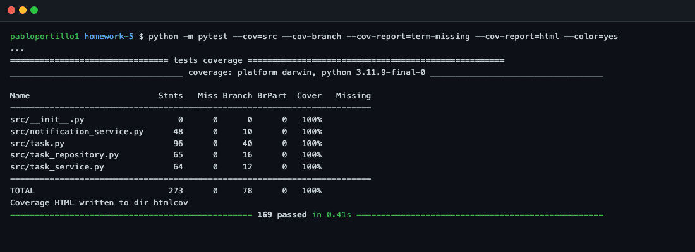
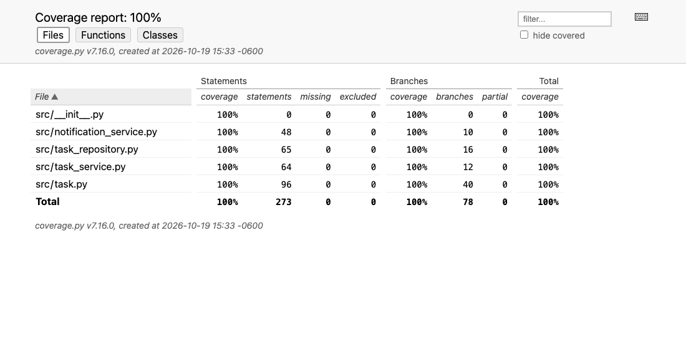
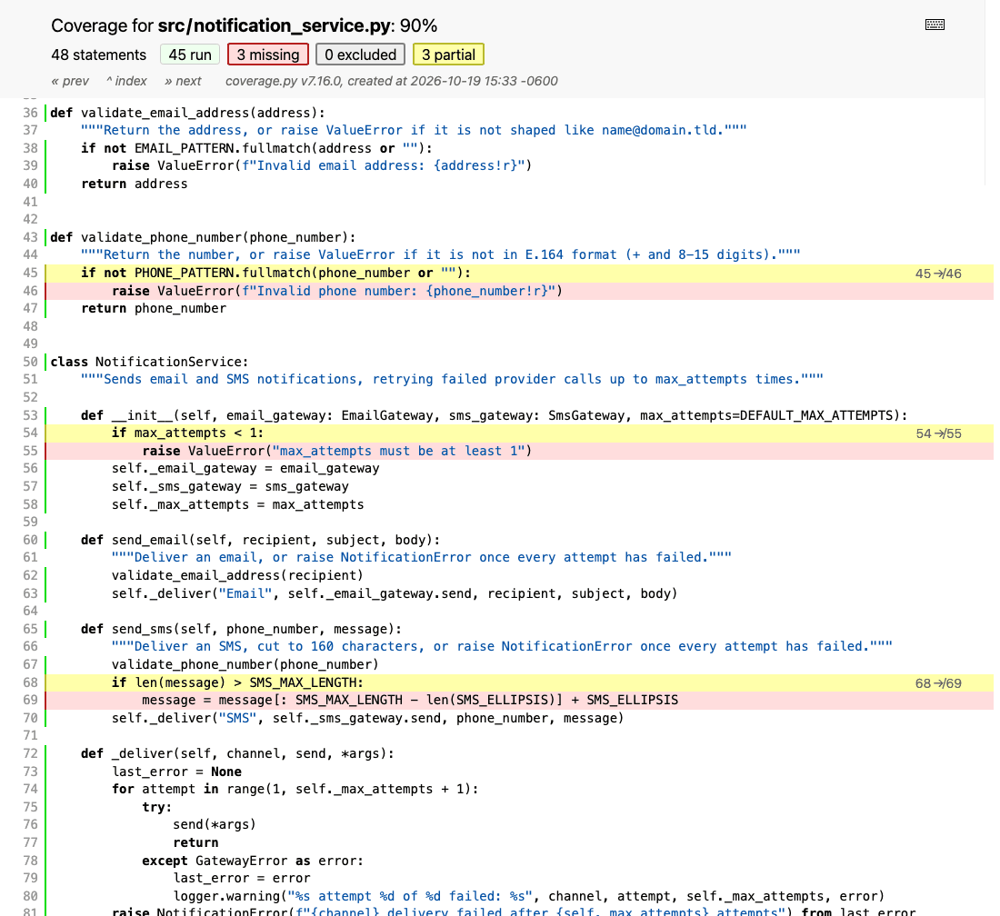

# Coverage Analysis — Homework 5 (TaskFlow)

All numbers below come from coverage.py 7.16 with branch measurement on, running the full suite on
Python 3.11:

```bash
python -m pytest --cov=src --cov-branch --cov-report=term-missing --cov-report=html
```

## Coverage Summary

| Metric             | Threshold | Achieved             | Status  |
| ------------------ | --------- | -------------------- | ------- |
| Statement Coverage | 80%       | 100% (273/273)       | ✅ Pass |
| Branch Coverage    | 80%       | 100% (78/78)         | ✅ Pass |
| Function Coverage  | 80%       | 100% (39/39)         | ✅ Pass |
| Line Coverage      | 80%       | 100% (273/273)       | ✅ Pass |
| Combined (graded)  | 80%       | 100% (351/351)       | ✅ Pass |

- **Function coverage** counts the 39 functions that contain executable code. The 7 `Protocol` methods
  (`Database.*`, `EmailGateway.send`, `SmsGateway.send`) are only a docstring each, so coverage.py
  finds no statement in them; they are covered in the "Untested Code Paths" section below.
- **Line coverage** equals statement coverage because coverage.py measures executable lines.
- **Combined** is the figure the grading workflow uses with `--cov-branch`: (covered statements +
  covered branches) / (statements + branches).



## Coverage by File

| File                    | Statements      | Branches      | Functions     | Lines           |
| ----------------------- | --------------- | ------------- | ------------- | --------------- |
| task.py                 | 100% (96/96)    | 100% (40/40)  | 100% (10/10)  | 100% (96/96)    |
| task_service.py         | 100% (64/64)    | 100% (12/12)  | 100% (12/12)  | 100% (64/64)    |
| task_repository.py      | 100% (65/65)    | 100% (16/16)  | 100% (11/11)  | 100% (65/65)    |
| notification_service.py | 100% (48/48)    | 100% (10/10)  | 100% (6/6)    | 100% (48/48)    |



The per-function view of the same report is in
[coverage-html-functions.png](screenshots/coverage-html-functions.png), and a source page with every
line marked as run is in [coverage-html-task-service.png](screenshots/coverage-html-task-service.png).

## How Coverage Goals Were Achieved

I wrote the suite in four steps and measured after each one. The table is cumulative: each row adds
one test file to the ones above it.

| Step                    | Tests | Statements | Branches | Combined | Run time |
| ----------------------- | ----: | ---------: | -------: | -------: | -------: |
| 1. Unit tests           |    51 |     62.64% |   51.28% |   60.11% |    0.08s |
| 2. + Integration tests  |    75 |     89.74% |   87.18% |   89.17% |    0.15s |
| 3. + Mocking tests      |   105 |     98.53% |   94.87% |   97.72% |    0.24s |
| 4. + Edge case tests    |   169 |    100.00% |  100.00% |  100.00% |    0.38s |

### Initial coverage: 60.11%

The unit tests alone reach 100% of `task.py` and call nothing else, yet they report 62.64% of
statement coverage for the whole of `src/`. The reason is that **108 of the 273 statements run at
import time**: `import` lines, constants, and every `class` and `def` line. `conftest.py` imports
the service, repository and notification modules to build its fixtures, so about 40% of each of them
is "covered" before a single test calls them. Branch coverage has no such inflation (no decision is
taken at import time), which is why I treated branches as the honest number throughout.

### Strategy applied

1. **Integration tests on the real repository** (60.11% → 89.17%). `TaskService` runs on the real
   `TaskRepository` over an in-memory `FakeDatabase`, with only the notification service mocked.
   Every business workflow goes through all three layers: create, edit, the TODO → IN_PROGRESS →
   DONE → ARCHIVED lifecycle, soft and permanent delete, overdue detection, and all search filters.
2. **Mocks for paths a fake cannot reach** (89.17% → 97.72%). A fake database never fails, so
   `DatabaseError` → `RepositoryError` translation, notification failures, gateway retries and call
   order needed autospec mocks with `side_effect`. After this step 4 lines were still missing, all
   of them input edge cases:

   

3. **Boundary and branch tests** (97.72% → 100%). 64 tests aimed at the remaining branches and,
   more importantly, at the exact limits of every rule: title length 3 and 100, description 500,
   due date equal to now, inclusive date ranges, SMS length 160, E.164 length 8 and 15 digits,
   `max_attempts` 0 and 1.

### Final coverage: 100%

Step 4 added 64 tests for the last 2.28 points. On its own that looks like diminishing returns. The
next section shows that this step did most of the useful work.

## Coverage vs. Test Strength: a Mutation Check

To see what the numbers do not show, I took a scratch copy of the project, introduced one small
bug at a time (a "mutant"), and ran two suites against it: steps 1-3 (97.72% coverage) and the full
suite. A mutant is "killed" when at least one test fails. No mutated code was committed.

| Mutant (single change in `src/`)                                       | Steps 1-3 (97.72%) | Full suite (100%) |
| ---------------------------------------------------------------------- | ------------------ | ----------------- |
| `task.py`: due date equal to now accepted (`<=` → `<`)                 | survived           | killed            |
| `task.py`: task overdue at its due instant (`>` → `>=`)                | survived           | killed            |
| `task.py`: 3-character title rejected (`<` → `<=`)                     | survived           | killed            |
| `task.py`: 100-character title rejected (`>` → `>=`)                   | survived           | killed            |
| `task.py`: 500-character description rejected (`>` → `>=`)             | survived           | killed            |
| `task.py`: empty description no longer clears it (`is not None` → truthy) | survived        | killed            |
| `task_repository.py`: `due_from` made exclusive (`<` → `<=`)           | survived           | killed            |
| `task_repository.py`: `due_to` made exclusive (`<=` → `<`)             | killed             | killed            |
| `task_repository.py`: one-instant range rejected (`>` → `>=`)          | survived           | killed            |
| `notification_service.py`: 160-character SMS truncated (`>` → `>=`)    | survived           | killed            |
| `notification_service.py`: 15-digit phone rejected (`{7,14}` → `{7,13}`) | survived         | killed            |
| `task_service.py`: duplicate of an unsaved task allowed                | killed             | killed            |

Ten of twelve realistic off-by-one bugs survived a suite with 97.72% coverage. Six of them are in
`task.py`, which was already at **100%** statement and branch coverage after step 1. Coverage tells
me a line ran; it does not tell me the line was checked at the value where it can go wrong.

## Untested Code Paths

No statement or branch of `src/` is left uncovered. These are the paths that coverage.py does not
measure, or that this suite deliberately does not exercise.

### task_repository.py and notification_service.py — `Protocol` contract methods

**Code**:

```python
class Database(Protocol):
    def insert(self, task: Task) -> int:
        """Store a new task and return the identifier the database assigned to it."""
```

**Reason**: `Database`, `EmailGateway` and `SmsGateway` describe the external systems the project
depends on. Their methods have no body to run; they exist so that `create_autospec` can build mocks
that reject calls with the wrong arguments, and to document the contract. The real implementations
(a database driver, an email provider, an SMS provider) are outside this project and belong to
system tests against those services.

**Risk**: Low. A mismatch between the protocol and a real driver would show up in the first system
test.

### Compound conditions — branch coverage is not condition coverage

**Code**:

```python
if existing is not None and (renamed_task_id is None or existing.task_id != renamed_task_id):
```

**Reason**: coverage.py records whether each `if` went both ways, not whether each condition inside
it was decisive. This line reaches 100% branch coverage with only two tests. I covered each
condition on purpose instead: no existing task (`test_rename_to_a_free_title_is_saved`), the same
task renamed (`test_rename_to_own_title_with_different_case_is_allowed`), another task (`test_rename_to_title_of_another_task_is_rejected`), and an existing task without an
id (`test_create_task_with_duplicate_title_does_not_save`). The same applies to the three-part date
check in `TaskFilter.__post_init__` and the title check in `TaskFilter.matches`.

**Risk**: Low, now that each condition has its own test, but nothing in the tooling would warn me if
one were removed.

### task_service.py — check-then-save race on duplicate titles

**Code**:

```python
task = Task(title, description, priority, due_date)
self._ensure_title_available(task.title)
self._repository.save(task)
```

**Reason**: two requests creating the same title at the same moment could both pass the check
before either saves. A single-process test suite cannot interleave them, and the real fix belongs
in the database (a unique index on the normalised title), which is outside this project.

**Risk**: Medium if TaskFlow ever serves several users at once; none for the single-owner system
described in the assignment.

### task.py — the real clock

**Reason**: every time-dependent test patches `task.datetime`, so `datetime.now()` itself is never
the real one under test. That is the point of patching it (tests run at a fixed instant and can move
time forward), and the call is a one-line standard library function.

**Risk**: Very low.

## Screenshots

| File | Shows |
| ---- | ----- |
| [test-execution.png](screenshots/test-execution.png) | `pytest -v`: all 169 tests passing |
| [coverage-summary.png](screenshots/coverage-summary.png) | Terminal report with statements, branches and missing lines |
| [coverage-html-report.png](screenshots/coverage-html-report.png) | HTML report index |
| [coverage-html-functions.png](screenshots/coverage-html-functions.png) | HTML report, per function |
| [coverage-html-task-service.png](screenshots/coverage-html-task-service.png) | Source view with every line marked as run |
| [coverage-html-before-edge-cases.png](screenshots/coverage-html-before-edge-cases.png) | Missing (red) and partial (yellow) lines after step 3 |
